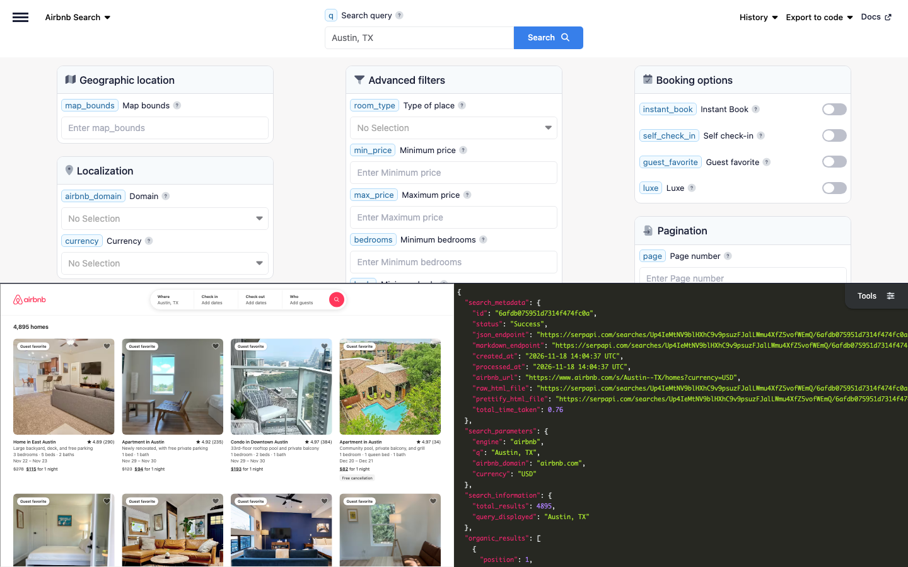

# Airbnb Scraper

Scrape Airbnb search results with SerpApi's Airbnb Search API. Search the places to stay in a city, region, neighborhood, or around a landmark, or in a map area, for your dates and guests, with Airbnb's filters for price, type of place, rooms and beds, property types, amenities, accessibility features, and booking options, on any Airbnb domain and in any supported currency. Get each place's listing ID, title, name, link, rating and number of reviews, badges, price for the stay with its breakdown and discounts, dates, rooms, beds, and baths, GPS coordinates, and photos.

## How to scrape Airbnb search results

Search Airbnb with a simple GET request:

```text
https://serpapi.com/search?engine=airbnb&q=Austin%2C+TX&api_key=SERPAPI_API_KEY
```

- `q` is the destination: anything you'd use in a regular Airbnb search, e.g., a city, a region, a neighborhood, or a landmark, such as `Austin, TX`, `Lake Tahoe`, `Paris, France`, or `Eiffel Tower`. Instead of `q`, you can set `map_bounds` to search a map area, e.g., `30.30,-97.70,30.24,-97.78` for Downtown Austin, TX. One of them is required.
- `api_key` is your SerpApi API key. Replace `SERPAPI_API_KEY` with it.
- `check_in_date` and `check_out_date` set the dates of the stay, e.g., `2027-03-12` and `2027-03-15`, to price every place for the same stay and only show the places available on these dates.
- `adults`, `children`, `infants`, and `pets` set the guests, e.g., `adults=4` or `pets=1`, to only show the places that can host them.
- `room_type`, `min_price`, `max_price`, `bedrooms`, `beds`, `bathrooms`, `property_types`, `amenities`, `accessibility_features`, and `host_languages` work like the filters of Airbnb, e.g., `room_type=entire_home`, `bedrooms=3`, or `amenities=pool,hot_tub,free_parking`.
- `instant_book`, `self_check_in`, `guest_favorite`, and `luxe` set to `true` only show the places with these booking options, e.g., Guest favorites.
- `airbnb_domain` and `currency` set the language, region, and currency of the results, e.g., `airbnb.co.uk` for British English and prices in GBP, or `currency=EUR`.
- `page` gets the next pages of results. Each page has up to 18 places.

A search needs `q` or `map_bounds`. Without either, the API returns `400` and "Either `q` or `map_bounds` should be specified." The dates must be set together and can't be in the past: `check_in_date` alone returns "Missing `check_out_date` parameter.", and a past date returns "`check_in_date` cannot be in the past." Unsupported filter values return errors such as "Unsupported values for `amenities` parameter: helipad" or "Unsupported `hotel` room_type parameter."

Without dates, Airbnb suggests a stay for each place and returns its price for that stay, so prices can't be compared between places or searches: on the first page for Austin, TX, every place is priced for 1 night, with check-in dates from 2026-11-18 to 2027-01-20, on its second page for 2 nights, and in London on `airbnb.co.uk` for 5 nights. `min_price` and `max_price` then filter the price of each place's suggested stay. Set `check_in_date` and `check_out_date` to price every place for the same stay.

A destination Airbnb doesn't recognize doesn't return an error: `q=qwxzzyplkvv` returns places from around the world, mostly hotels. Check the `gps_coordinates` of the places if your destinations come from user input.

[Register at SerpApi](https://serpapi.com?utm_source=github_airbnb_scraper) to get your API key, and keep it private.

### Playground

Try the request live in the [SerpApi Playground](https://serpapi.com/playground?engine=airbnb&q=Austin%2C+TX&utm_source=github_airbnb_scraper).

[](https://serpapi.com/playground?engine=airbnb&q=Austin%2C+TX&utm_source=github_airbnb_scraper)

## Code examples

The code examples read your API key from the `SERPAPI_API_KEY` environment variable:

```bash
export SERPAPI_API_KEY="SERPAPI_API_KEY"
```

Each example searches Airbnb for places to stay in Austin, TX, and prints the title, price, and price qualifier of each place.

### curl integration

Send the request with curl, which prints the full JSON response:

```bash
curl --get https://serpapi.com/search \
 --data-urlencode engine="airbnb" \
 --data-urlencode q="Austin, TX" \
 --data-urlencode api_key="$SERPAPI_API_KEY"
```

### JavaScript integration

Install the [SerpApi JavaScript library](https://github.com/serpapi/serpapi-javascript) and set your project to use ES modules:

```bash
npm install serpapi
npm pkg set type=module
```

Create an `index.js` file:

```javascript
import { getJson } from "serpapi";

const results = await getJson({
  engine: "airbnb",
  api_key: process.env.SERPAPI_API_KEY,
  q: "Austin, TX",
});

for (const place of results.organic_results ?? []) {
  console.log(place.title, place.price, place.price_qualifier);
}
```

Run it with `node index.js`.

### Python integration

Install the [SerpApi Python library](https://github.com/serpapi/serpapi-python):

```bash
pip install serpapi
```

Create a `main.py` file:

```python
import os
import serpapi

client = serpapi.Client(api_key=os.getenv("SERPAPI_API_KEY"))
results = client.search({
    "engine": "airbnb",
    "q": "Austin, TX",
})

for place in results.get("organic_results", []):
    print(place["title"], place["price"], place["price_qualifier"])
```

Run it with `python main.py`.

### Ruby integration

Install the [SerpApi Ruby library](https://github.com/serpapi/serpapi-ruby):

```bash
gem install serpapi
```

Create a `main.rb` file:

```ruby
require "serpapi"

client = SerpApi::Client.new(engine: "airbnb", api_key: ENV.fetch("SERPAPI_API_KEY"))
results = client.search(q: "Austin, TX")

results.fetch(:organic_results, []).each do |place|
  puts "#{place[:title]} #{place[:price]} #{place[:price_qualifier]}"
end

client.close
```

Run it with `ruby main.rb`.

### PHP integration

Install the [SerpApi PHP library](https://github.com/serpapi/serpapi-php):

```bash
composer require serpapi/serpapi-php
```

Create an `index.php` file:

```php
<?php
require 'vendor/autoload.php';

use SerpApi\Client;

$client = new Client(getenv('SERPAPI_API_KEY'), 'airbnb');
$results = $client->search([
  'q' => 'Austin, TX',
]);

foreach ($results->organic_results ?? [] as $place) {
  echo $place->title . ' ' . $place->price . ' ' . $place->price_qualifier . PHP_EOL;
}
```

Run it with `php index.php`.

### Go integration

Create a Go module and install the [SerpApi Go library](https://github.com/serpapi/serpapi-golang):

```bash
go mod init example.com/airbnb
go get github.com/serpapi/serpapi-golang
```

Create a `main.go` file:

```go
package main

import (
	"fmt"
	"os"

	"github.com/serpapi/serpapi-golang"
)

func main() {
	setting := serpapi.NewSerpApiClientSetting(os.Getenv("SERPAPI_API_KEY"))
	setting.Engine = "airbnb"
	client := serpapi.NewClient(setting)

	results, err := client.Search(map[string]string{
		"q": "Austin, TX",
	})
	if err != nil {
		panic(err)
	}

	organicResults, _ := results["organic_results"].([]interface{})
	for _, item := range organicResults {
		place := item.(map[string]interface{})
		fmt.Println(place["title"], place["price"], place["price_qualifier"])
	}
}
```

Run it with `go run .`.

### Rust integration

Create a Cargo project and add the [SerpApi Rust library](https://github.com/serpapi/serpapi-rust) and Tokio:

```bash
cargo new airbnb && cd airbnb
cargo add serpapi tokio --features tokio/full
```

Replace `src/main.rs` with:

```rust
use serpapi::serpapi::Client;
use std::collections::HashMap;
use std::env;

#[tokio::main]
async fn main() -> Result<(), Box<dyn std::error::Error>> {
    let mut default = HashMap::new();
    default.insert("api_key".to_string(), env::var("SERPAPI_API_KEY")?);
    default.insert("engine".to_string(), "airbnb".to_string());
    let client = Client::new(default)?;

    let mut parameter = HashMap::new();
    parameter.insert("q".to_string(), "Austin, TX".to_string());

    let results = client.search(parameter).await?;
    if let Some(organic_results) = results["organic_results"].as_array() {
        for place in organic_results {
            println!(
                "{} {} {}",
                place["title"].as_str().unwrap_or_default(),
                place["price"].as_str().unwrap_or_default(),
                place["price_qualifier"].as_str().unwrap_or_default()
            );
        }
    }
    Ok(())
}
```

Run it with `cargo run`.

### Other programming languages

Official libraries are also available for [Java](https://github.com/serpapi/serpapi-java), [.NET](https://github.com/serpapi/serpapi-dotnet), [Swift](https://github.com/serpapi/serpapi-swift), and [C++](https://github.com/serpapi/serpapi-cpp). See [SerpApi integrations](https://serpapi.com/integrations?utm_source=github_airbnb_scraper) for setup guides, or use a simple GET request from any programming language.

### Errors

Failed requests return an HTTP error status and a JSON body with an `error` message. The most common are `401` for an invalid API key, `400` for a search without `q` or `map_bounds`, and `429` when you exceed your hourly throughput limit or run out of searches. See [API status and error codes](https://serpapi.com/api-status-and-error-codes?utm_source=github_airbnb_scraper) for the full list.

A search without places, e.g., with `max_price=10` in Austin, TX, still returns `200`, with `search_metadata.status` set to `Success`, `search_information.organic_results_state` set to `Fully empty`, and the error "Airbnb hasn't returned any results for this query.", so check for `error` before reading `organic_results`.

## Output formats: JSON and Markdown

Choose structured JSON for applications or Markdown for LLMs and AI agents:

- JSON is the default output and is useful when you need individual result fields.
- Add `output=md` to receive Markdown instead, which is more token-efficient.

Markdown is plain text, not JSON: YAML front matter with the search metadata and parameters, followed by the number of results and the destination, a table of the places with their listing ID, title linked to the place, name, description, rating, reviews, badges, price, old price, price qualifier, price disclaimers, dates, details, bedrooms, beds, and bathrooms, coordinates, thumbnail, photo links, highlights, and free cancellation and new listing flags, and links to the other pages. The price breakdown and the prices as numbers, in the `extracted_` fields, are only in the JSON response. Read the response body as text instead of parsing it.

| Client | Markdown request |
|--------|------------------|
| curl | `--data-urlencode output="md"` |
| Python | `client.search({..., "output": "md"})` |
| PHP | `$client->md([...])` |
| Go | `client.Md(map[string]string{...})` |
| Rust | `client.md(parameter).await?` |

If your SDK doesn't have a Markdown helper yet, send a plain HTTP request with `output=md` and read the body as text. Learn more about [Markdown output](https://serpapi.com/markdown-output?utm_source=github_airbnb_scraper).

## Airbnb Search API parameters

See the [Airbnb Search API documentation](https://serpapi.com/airbnb-search-api?utm_source=github_airbnb_scraper) for more details.

| Name | Description | Requirement |
|------|-------------|-------------|
| **Search query** | | |
| `q` | The destination to search for: anything you'd use in a regular Airbnb search, i.e., a city, a region, a neighborhood, or a landmark (e.g., `Austin, TX`, `Lake Tahoe`, `Paris, France`, or `Eiffel Tower`). `search_information.query_displayed` shows the destination searched. A destination Airbnb doesn't recognize (e.g., `qwxzzyplkvv`) doesn't return an error, but places from around the world, mostly hotels. With `map_bounds`, the places come from the map area. | Required, unless `map_bounds` is set |
| **Geographic location** | | |
| `map_bounds` | The GPS coordinates of the map area to search in, like moving the map on Airbnb, as `north,east,south,west`: north and south are latitudes, and east and west are longitudes (e.g., `30.30,-97.70,30.24,-97.78` for Downtown Austin, TX). Only places within the area are shown. It can be used alone or with `q`. Without `q`, `title` is the name given by the host, and the places have no `reviews`, `details`, or room counts. | Required, unless `q` is set |
| **Localization** | | |
| `airbnb_domain` | The Airbnb domain to use, which sets the language, the region, and the default currency of the results (e.g., `airbnb.co.uk` for British English and GBP, `airbnb.fr` for French and EUR, or `airbnb.jp` for Japanese and JPY). Defaults to `airbnb.com`. See the [supported Airbnb domains](https://serpapi.com/airbnb-domains?utm_source=github_airbnb_scraper) for all 116 domains. | Optional |
| `currency` | The currency of the prices (e.g., `EUR` or `JPY`). Defaults to the currency of `airbnb_domain` (e.g., USD for `airbnb.com`). `min_price` and `max_price` are in this currency. See the [supported Airbnb currencies](https://serpapi.com/airbnb-currencies?utm_source=github_airbnb_scraper) for all 69 currency codes. | Optional |
| **Dates and guests** | | |
| `check_in_date` | The check-in date, in YYYY-MM-DD format (e.g., `2027-03-12`). Must be used with `check_out_date`, and can't be in the past. With dates, every place is priced for the same stay, and only the places available on these dates are shown. Without dates, Airbnb suggests a stay for each place and prices it for that stay, with its dates in `check_in_date` and `check_out_date` of the result. The suggested stays vary by search and page (e.g., 1 night on the first page for Austin, TX, 2 nights on its second page, and 5 nights for London on `airbnb.co.uk`). | Optional |
| `check_out_date` | The check-out date, in YYYY-MM-DD format (e.g., `2027-03-15`). Must be used with `check_in_date`, and be later than it. | Optional |
| `adults` | The number of adults, ages 13 or above (e.g., `4`). | Optional |
| `children` | The number of children, ages 2 to 12 (e.g., `2`). | Optional |
| `infants` | The number of infants, under 2 (e.g., `1`). | Optional |
| `pets` | The number of pets (e.g., `1`). When set, only the places allowing pets are shown. | Optional |
| **Advanced filters** | | |
| `room_type` | The type of place, as a single value: `entire_home` (Entire home) or `private_room` (Private room). Defaults to any type. To only show hotels, use `hotel` in `property_types`. | Optional |
| `min_price` | The minimum price of the stay, including all fees, like Airbnb's price range filter (e.g., `500`), in the currency of the results. With dates, it applies to the whole stay. Without dates, it applies to the price of each place's suggested stay, which is often a single night, so set dates to filter by the price of a given stay. Prices can be slightly outside the range (e.g., a 2-night stay at $462 with `min_price=500`). Can't be greater than `max_price`. | Optional |
| `max_price` | The maximum price of the stay, including all fees (e.g., `2000`), in the currency of the results. Like `min_price`, it applies to the whole stay with dates (e.g., places at $340 to $598 for 3 nights with `max_price=600`), and to each place's suggested stay without dates (e.g., 1-night stays at $67 to $149 with `max_price=150`). | Optional |
| `bedrooms` | The minimum number of bedrooms (e.g., `3`). | Optional |
| `beds` | The minimum number of beds (e.g., `4`). | Optional |
| `bathrooms` | The minimum number of bathrooms (e.g., `2`). | Optional |
| `property_types` | The property types to show, as a comma-separated list (e.g., `house,guesthouse`): `house` (House), `apartment` (Apartment), `guesthouse` (Guesthouse), or `hotel` (Hotel). `house` also returns rooms and guest suites (e.g., Room in East Austin), so add `room_type=entire_home` to only show entire places. `hotel` only shows hotels. | Optional |
| `amenities` | The amenities the places must have, as a comma-separated list (e.g., `pool,hot_tub,free_parking`). See the [supported Airbnb amenities](https://serpapi.com/airbnb-amenities?utm_source=github_airbnb_scraper) for all 25 amenities, e.g., `wifi`, `kitchen`, `dedicated_workspace`, `ev_charger`, or `waterfront`. | Optional |
| `accessibility_features` | The accessibility features the places must have, as a comma-separated list (e.g., `step_free_access`): `step_free_access`, `disabled_parking_spot`, `wide_guest_entrance`, `step_free_bedroom_access`, `wide_bedroom_entrance`, `step_free_bathroom_access`, `wide_bathroom_entrance`, `toilet_grab_bar`, `shower_grab_bar`, `step_free_shower`, `shower_or_bath_chair`, or `ceiling_or_mobile_hoist`. Few places list these features, so each one narrows the results: in Austin, TX, `step_free_access` returns 37 places, `step_free_shower` 5, and both together none. See the [supported Airbnb accessibility features](https://serpapi.com/airbnb-accessibility-features?utm_source=github_airbnb_scraper) for their names on Airbnb. | Optional |
| `host_languages` | The languages the host must speak, as a comma-separated list of language codes (e.g., `es` or `en,es`). See the [supported Airbnb host languages](https://serpapi.com/airbnb-host-languages?utm_source=github_airbnb_scraper) for all 70 languages. | Optional |
| **Booking options** | | |
| `instant_book` | Set to `true` to only show the places that can be booked without waiting for the host's approval, or `false` (default). | Optional |
| `self_check_in` | Set to `true` to only show the places with self check-in, or `false` (default). | Optional |
| `guest_favorite` | Set to `true` to only show Guest favorites, the places guests love most on Airbnb, which have the Guest favorite badge, or `false` (default). | Optional |
| `luxe` | Set to `true` to only show Airbnb Luxe places, luxury homes with elevated design, which have the Luxe badge (e.g., 63 places around Lake Tahoe), or `false` (default). | Optional |
| **Pagination** | | |
| `page` | The page number (e.g., `1` (default) for the first page, `2` for the second). Each page has up to 18 places. Like Airbnb, `serpapi_pagination` links to up to 15 pages, and page 15 has no `next`, but higher pages still return places (e.g., pages 16, 17, and 20 for Austin, TX). Pages can repeat places, so deduplicate them by `listing_id`. | Optional |
| **SerpApi parameters** | | |
| `engine` | Set to `airbnb`. | Required |
| `api_key` | Your private SerpApi API key. | Required |
| `no_cache` | Set to `true` to request fresh results instead of using the one-hour cache. Can't be combined with `async`. | Optional |
| `async` | Set to `true` for later retrieval through the [Searches Archive API](https://serpapi.com/search-archive-api?utm_source=github_airbnb_scraper). Can't be combined with `no_cache` or used with Ludicrous Speed enabled. | Optional |
| `zero_trace` | Enterprise only. Set to `true` to skip storing search parameters, files, and metadata on SerpApi servers. | Optional |
| `output` | Set to `json` (default), `html` for the raw HTML of the Airbnb search page, or `md` for Markdown. | Optional |
| `json_restrictor` | Limit the JSON response to the fields you need. See the [JSON Restrictor](https://serpapi.com/json-restrictor?utm_source=github_airbnb_scraper) documentation. | Optional |

## Available data on Airbnb search results (JSON response)

Each item in `organic_results` is a place to stay, i.e., a home, a room, or a hotel, with its rating, badges, price for a stay with its breakdown, the dates of that stay, rooms and beds, GPS coordinates, and photos. `search_information` shows the number of results and the destination, and `serpapi_pagination` links to the other pages. The field guides below describe the possible fields and their types; they aren't literal API responses.

### What you get depends on the place and the search

Some fields appear only for some places or searches:

| Place or search | Fields |
|-----------------|--------|
| A home or a room | `title` with the type of place and the area, e.g., Home in East Austin or Room in East Austin, and `details` with its rooms, beds, and baths, e.g., 3 bedrooms, 5 beds, and 2 baths, also as numbers in `bedrooms`, `beds`, and `bathrooms`. A place whose `details` list no bedrooms, e.g., 1 queen bed and 1 bath, has no `bedrooms`. |
| A hotel, with the Featured hotel badge | `title` with the hotel's name, e.g., Hotel Van Zandt, `details` with the hotel's amenities, e.g., Pool, Gym, and Spa, or with the beds and bath of the room priced, e.g., 1 king bed and 1 bath, also as numbers in `beds` and `bathrooms`, `price_disclaimers` with the room priced, e.g., Price may vary by room type and King accessible, and an Airbnb credit in `highlights`, e.g., +$67 Airbnb credit. Hotels have no `bedrooms`, often have no `details`, and some prices include a Resort fee in `price_breakdown`. |
| A place with a lower price | `old_price` and `extracted_old_price` with the price before a discount, e.g., $377 for a 2-night stay at $355 after a Long stay discount, or the usual price when the host recently lowered it, e.g., $278 for a 1-night stay at $115. A lowered price also has a note in `price_disclaimers` that the host lowered the price for these dates. Some discounted places have no `old_price`, and their discount is only in `price_breakdown`. |
| A new place without enough reviews | `is_new_listing` set to true, and no `rating` or `reviews` |
| A place with free cancellation | `free_cancellation` set to true, usually with Free cancellation in `highlights` |
| A search on `airbnb.co.uk` or `airbnb.fr` | `host_type`, e.g., Individual host or Business host on `airbnb.co.uk`, and Particulier or Professionnel on `airbnb.fr`, and price breakdowns with taxes, e.g., Taxes and fees and Total. Without dates, homes on these domains have no `details` or room counts. |
| A search with only `map_bounds` | `title` with the name given by the host, the same as `name`, and no `reviews`, `details`, or room counts. `search_information` has no `query_displayed`. |
| Another domain or `currency` | Localized text and prices, e.g., ¥14,867 JPY for 1 night with `currency=JPY`, or 292 € au total, Appartement ⋅ Montmartre, and the badge Coup de cœur voyageurs on `airbnb.fr` |

Each place has a `listing_id` and a `link` to its page on Airbnb, with the dates of its price and the guests you set, in the form `https://www.airbnb.com/rooms/<listing_id>?check_in=2027-03-12&check_out=2027-03-15&adults=4&children=2&infants=1`. Prices are for the whole stay, as displayed, e.g., $115 or £1,644, with `price_qualifier` saying what they cover, e.g., for 1 night on `airbnb.com` or total on `airbnb.co.uk`, and as numbers in the matching `extracted_` fields. `price_breakdown` lists the nightly rate, discounts as negative amounts, e.g., -$24.30 for a Long stay discount, and fees, e.g., a Resort fee of $40.95 at Hotel Van Zandt. `search_metadata.airbnb_url` links to the same search on Airbnb. `search_information.total_results` is Airbnb's estimate and changes between pages of the same search, e.g., 4895 on page 1 and 9844 on page 2 for Austin, TX.

To get the next page, increase `page` or follow `serpapi_pagination.next`. `position` restarts at 1 on each page. Pages can repeat places, e.g., pages 1 and 2 for Austin, TX share 2 places, so deduplicate them by `listing_id`. Without dates, the suggested stays can change between pages, e.g., 1 night on page 1 and 2 nights on page 2. `serpapi_pagination` links to up to 15 pages, and page 15 has no `next`.

### Organic results

Each place in `organic_results` can include these fields:

```json
{
  "organic_results": [
    {
      "position": "Integer - Position of the place on the page, starting at 1 on each page",
      "listing_id": "String - Airbnb ID of the place, e.g., 1714841954894293477",
      "title": "String - Type of place and area, or name of a hotel, e.g., Home in East Austin or Hotel Van Zandt",
      "name": "String - Name of the place, given by its host",
      "description": "String - Short description of the place, e.g., Large backyard, deck, and free parking",
      "link": "String - Link to the place on Airbnb, with the dates of its price and the guests",
      "rating": "Float - Average rating out of 5, e.g., 4.89",
      "reviews": "Integer - Number of reviews, e.g., 290",
      "is_new_listing": "Boolean - true for a new place without enough reviews for a rating",
      "badges": "Array[String] - Badges of the place, e.g., Guest favorite, Superhost, Featured hotel, or Luxe",
      "price": "String - Price of the stay, as displayed, e.g., $115",
      "extracted_price": "Integer - Price of the stay as a number, e.g., 115",
      "old_price": "String - Price before a discount, or the usual price when the host recently lowered it, as displayed, e.g., $278",
      "extracted_old_price": "Integer - Price before a discount as a number, e.g., 278",
      "price_qualifier": "String - What the price covers, e.g., for 1 night, for 5 nights, or total",
      "price_breakdown": [
        {
          "description": "String - Line of the price, e.g., 2 nights x $243.00, Long stay discount, Resort fee, or Price after discount",
          "price": "String - Amount of the line, as displayed, negative for discounts, e.g., -$24.30",
          "extracted_price": "Float - Amount of the line as a number, e.g., -24.3",
          "old_price": "String - Amount of the line before the host lowered the price, e.g., $278.00",
          "extracted_old_price": "Float - Amount of the line before the host lowered the price as a number, e.g., 278.0"
        }
      ],
      "price_disclaimers": "Array[String] - Notes on the price: that the host recently lowered it, or the room priced at a hotel, e.g., Price may vary by room type",
      "check_in_date": "String - Check-in date of the price, in YYYY-MM-DD format, e.g., 2026-11-22",
      "check_out_date": "String - Check-out date of the price, in YYYY-MM-DD format, e.g., 2026-11-23",
      "details": "Array[String] - Rooms, beds, and baths of a home, e.g., 3 bedrooms, 5 beds, and 2 baths, or amenities of a hotel, e.g., Pool, Gym, and Spa",
      "bedrooms": "Integer - Number of bedrooms, e.g., 3",
      "beds": "Integer - Number of beds, e.g., 5",
      "bathrooms": "Integer or Float - Number of bathrooms, e.g., 2 or 2.5",
      "host_type": "String - Type of host, on some domains, e.g., Individual host or Business host on airbnb.co.uk",
      "highlights": "Array[String] - Highlights of the booking, e.g., Free cancellation, Pay $0 today, or +$67 Airbnb credit",
      "free_cancellation": "Boolean - true if the place offers free cancellation",
      "gps_coordinates": {
        "latitude": "Float - Latitude of the place, e.g., 30.2462",
        "longitude": "Float - Longitude of the place, e.g., -97.7765"
      },
      "thumbnail": "String - Link to the main photo of the place",
      "images": "Array[String] - Links to photos of the place, usually 6"
    }
  ]
}
```

`title`, `name`, `link`, `price`, `price_qualifier`, `price_breakdown`, the dates, `gps_coordinates`, `thumbnail`, and `images` are on every place. `rating` and `reviews` are missing on new places. `details` and the room counts are often missing on hotels, and on homes without dates on `airbnb.co.uk` and `airbnb.fr`.

### Search information and pagination

`search_information` describes the search, and `serpapi_pagination` links to the other pages:

```json
{
  "search_information": {
    "total_results": "Integer - Airbnb's estimate of the number of places, e.g., 4895",
    "query_displayed": "String - Destination searched, e.g., Austin, TX",
    "organic_results_state": "String - Fully empty when the search has no places"
  },
  "serpapi_pagination": {
    "current": "Integer - Current page",
    "previous": "String - SerpApi link to the previous page",
    "next": "String - SerpApi link to the next page",
    "other_pages": {
      "2": "String - SerpApi link to page 2, for every other page up to page 15"
    }
  }
}
```

A search without places has `organic_results_state` and an `error`, but no `organic_results` or `serpapi_pagination`.

## AI agents and no-code

### MCP

Give AI agents and assistants an Airbnb lodging search tool with the hosted [SerpApi MCP server](https://github.com/serpapi/serpapi-mcp) at `https://mcp.serpapi.com/mcp`.

Claude Code:

```bash
claude mcp add --transport http serpapi https://mcp.serpapi.com/mcp --header "Authorization: Bearer $SERPAPI_API_KEY"
```

Codex, which reads the key from `SERPAPI_API_KEY`:

```bash
codex mcp add serpapi --url https://mcp.serpapi.com/mcp --bearer-token-env-var SERPAPI_API_KEY
```

Other MCP clients:

```json
{
  "mcpServers": {
    "serpapi": {
      "type": "http",
      "url": "https://mcp.serpapi.com/SERPAPI_API_KEY/mcp"
    }
  }
}
```

The server's engine catalog includes the `airbnb` engine, and its `serpapi://engines/airbnb` resource describes the parameters. Ask your agent to search Airbnb with the `airbnb` engine and a destination in `q`. The resulting tool call looks like this:

```json
{
  "name": "search",
  "arguments": {
    "params": {
      "engine": "airbnb",
      "q": "Austin, TX"
    }
  }
}
```

See the [MCP integration guide](https://serpapi.com/integrations/mcp?utm_source=github_airbnb_scraper) for more clients and self-hosting.

### CLI

Search Airbnb from your terminal or from AI agent workflows with the [SerpApi CLI](https://github.com/serpapi/serpapi-cli):

```bash
brew tap serpapi/homebrew-tap
brew install serpapi-cli
```

The CLI picks up `SERPAPI_API_KEY` from your environment. You can also run `serpapi login` to save a key.

```bash
serpapi search engine=airbnb q="Austin, TX"
serpapi search engine=airbnb q="Austin, TX" check_in_date=2027-03-12 check_out_date=2027-03-15 adults=2 --fields "organic_results[].{title, price, price_qualifier, rating, link}"
serpapi search engine=airbnb q="Austin, TX" check_in_date=2027-03-12 check_out_date=2027-03-15 adults=2 output=md
```

### No-code tools

Use SerpApi APIs without writing code:

- [NoCodeSerpApi](https://nocodeserpapi.com/)
- [SerpApi with n8n](https://serpapi.com/blog/tag/n8n/)
- [SerpApi with Make](https://serpapi.com/blog/tag/make/)
- [More integrations](https://github.com/serpapi/serpapi-integrations/)

## Use cases

- Compare the prices of places to stay across neighborhoods, dates, and currencies, with `check_in_date` and `check_out_date` set so that every place is priced for the same stay.
- Research the short-term rental market of an area, e.g., typical prices by number of bedrooms, or the share of places that allow pets with `pets=1`.
- Track where your own listing ranks for a destination search, by its `listing_id` and position across pages.
- Find accessible or pet-friendly places with `accessibility_features` and `pets`, e.g., places with a step-free guest entrance in Austin, TX.
- Monitor the prices of a destination for given dates over time, e.g., ahead of a large local event.
- Give AI agents and travel assistants a lodging search tool, e.g., for "a pet-friendly home in Lake Tahoe for 4 guests in March".

## Related scrapers

- [Google Flights Scraper](https://github.com/serpapi/google-flights-scraper): flight prices and itineraries from Google Flights
- [Google Maps Scraper](https://github.com/serpapi/google-maps-scraper): places on Google Maps
- [Eventbrite Scraper](https://github.com/serpapi/eventbrite-scraper): events in a city from Eventbrite

## Resources

- [How to Scrape Airbnb Data](https://serpapi.com/blog/how-to-scrape-airbnb-data/)

## Contact

Feel free to reach out at [contact@serpapi.com](mailto:contact@serpapi.com).
